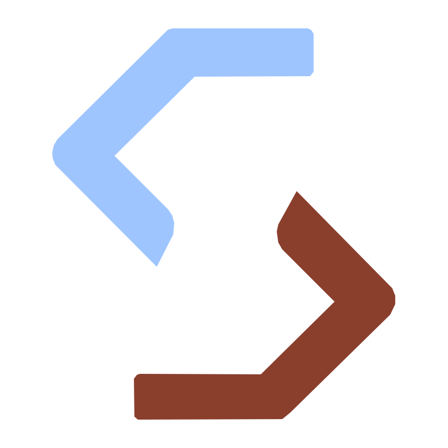

<p align="center">
  
</p>

# Snippet

Write in Markdown. Keep your source in Git. Publish a static website.

Snippet is a small publishing system for one author: a personal site, a notebook,
or a home for project updates. Keep your content in your own **public or private
repository** and use the official Docker image to preview and build it. Your host
receives ordinary static files, with no PHP, database, or server application to run.

- **Write your way.** Markdown articles and pages, ordered tags, local attachments,
  optional article covers, and a homepage featuring your newest article.
- **Work with a coding agent.** Bundled authoring instructions and an inspectable
  CLI help your agent create content, edit configuration, and customize styles.
- **Make it yours.** Light and dark themes, responsive navigation, stable CSS
  tokens, your own fonts and assets, and optional site JavaScript. The starter
  includes **Snippet Logo, a custom header font created specifically for Snippet**.
- **Preview as you write.** Live reload, useful validation errors, and the last
  working publication preserved after an invalid edit.
- **Publish with confidence.** Metadata, supported Markdown, covers, assets, and
  internal links are checked before the complete build replaces `public/`.
- **Share readable pages.** Semantic HTML, keyboard navigation, print styles,
  canonical URLs, Open Graph and Twitter/X metadata, a themed 404 page, and a
  metadata-only `llms.txt` index.
- **Keep hosting simple.** Reproducible static builds from the Docker image and a
  [ready-to-copy GitHub Pages workflow](examples/github-pages.yml), including
  project-path and custom-domain guidance.

[Explore the demo and guides](https://wanted80.github.io/snippet/) ·
[Start your site](#quick-start) · [Installation and deployment](INSTALL.md) ·
[CSS customization](#stable-css-api) · [Author with an agent](#write-and-style-with-a-coding-agent)

## Quick start

You need Docker and a text editor. These commands work in a Linux/macOS shell;
on Windows, use WSL 2. Start in an empty directory for **your own site**:

```bash
mkdir my-site
cd my-site

# Reuse this helper in the current shell from your site's directory.
snippet() {
  docker run --rm --user "$(id -u):$(id -g)" \
    --volume "$PWD:/workspace" \
    ghcr.io/wanted80/snippet:v4.4.0 "$@" # x-release-please-version
}

snippet init
snippet new page about
```

Set your name, description, and final HTTPS `url` in `site/config.php`.
Write a few paragraphs in `content/pages/about/page.md`, and complete its
`meta.php` with a title and description. The generated files are intentionally
incomplete until you fill them in. See the [content examples](#content) for the
exact format, or follow [the first-page walkthrough](https://wanted80.github.io/snippet/articles/start-your-site/).

```bash
snippet validate
snippet build
```

Your website is now in `public/`. To preview it with live reload:

```bash
docker run --rm --init --user "$(id -u):$(id -g)" \
  --publish 127.0.0.1:8080:8080 --volume "$PWD:/workspace" \
  ghcr.io/wanted80/snippet:v4.4.0 preview --host=0.0.0.0 --port=8080 # x-release-please-version
```

Open `http://127.0.0.1:8080`. Edit, save, and see the browser refresh.
Stop preview with Ctrl+C. [INSTALL.md](INSTALL.md#content-only-container-preview)
has Compose and hardened container examples.

Keep `content/`, `site/`, and the generated agent instructions in Git. Add
`/public/`, `/.snippet-build-*/`, and `/.snippet-backup-*/` to your `.gitignore`;
output is rebuilt, not committed. Create a public or private remote repository
and push your source. To publish automatically, copy the
[example workflow](examples/github-pages.yml) and follow the
[Pages setup](INSTALL.md#ci-validation-build-and-github-pages).
A private source repository does not imply a private website; Pages availability
depends on your GitHub plan, as explained in that guide.

You own the writing and `site/` customization. The image contains the engine and
theme; you do not need to fork Snippet. Updating its pinned version and rebuilding
brings theme fixes without replacing your source files.

### Write and style with a coding agent

`snippet init` includes a `snippet-authoring` skill and repository instructions.
Use them with a coding agent that can read your workspace, edit files, and run
its configured Snippet command. For example:

> Use the snippet-authoring skill to create an About page from these notes, add
> it to navigation, then validate and build the site.

> Use the snippet-authoring skill to turn these notes into an article. Suggest a
> title, description, and tags; use my supplied publication date, then validate
> and build.

> Use the snippet-authoring skill to give my site a warm light palette and a
> readable dark palette. Adjust typography and spacing in site/site.css, then
> validate, build, and review narrow and wide layouts in both themes.

The agent can discover the installed content, configuration, and theme contracts
through `inspect ... --json`, rather than guessing supported fields or CSS tokens.
You review the writing and design in the same source files you would edit by hand.
Bring your own coding agent; Snippet supplies the skill and CLI, and its publishing
engine runs without an AI service. See [the agent guide](https://wanted80.github.io/snippet/articles/working-with-agents/)
for more examples and [Agent CLI](#agent-cli) for the machine-readable interface.

### Develop Snippet itself

For engine and theme contributions, clone this repository and use Docker with Make:

```bash
git clone https://github.com/wanted80/snippet.git
cd snippet
cp .env.example .env
make demo-check
make docker-preview
```

`make demo-check` validates and builds the documentation demo in a temporary
workspace. Contributor preview runs at `https://localhost:8443/` and watches
`demo/content/`, root `site/`, and the installed theme. See
[the contributor setup](INSTALL.md#contributor-docker-make-and-https-preview).

## Why I created Snippet

I created Snippet because I wanted a publishing system that met my own needs without relying on a third-party tool and allowed me to build and publish my website through GitHub workflow automation.

It was also a perfect opportunity to explore how AI can turn an idea into a working project. I did not write a single line of code myself; instead, I contributed ideas, suggestions, part of my knowledge, and the guidance needed to lead the agent through the project.

I have been working with AI for more than a year, and I believe now is the perfect time to use it as a partner. It makes it possible to build things that were previously out of reach outside our professional work—not because the ideas were missing, but because there was never enough time or more than two hands to do everything. It is also a great time to create more open-source projects driven by our own ideas and needs.

I mainly used GPT 5.6 Sol with medium and xhigh reasoning, and GPT 5.6 Luna with high and xhigh reasoning for smaller tasks. Sometimes I also used subchats in Codex, asking Luna to work within Sol's session and vice versa.

## Runtime and development dependencies

The publishing engine runs on PHP 8.5+ and the required PHP extensions listed in `composer.json`. Its application code uses the PHP standard library and does not require third-party packages at runtime. A generated site is static and needs neither PHP nor Composer when it is hosted.

Composer is project infrastructure. It provides the PHP platform requirement, the PSR-4 autoloader, and the project scripts. Packages listed under `require-dev` are used only to develop and verify Snippet: they cover testing, code coverage, formatting, refactoring, static analysis, mutation testing, and browser checks. They are not dependencies of the generated site or of the publishing engine's runtime behavior.

## Agent CLI

Agents can query the installed engine before a workspace exists:

```text
bin/snippet inspect capabilities --json
bin/snippet inspect theme --json
bin/snippet inspect config --json
bin/snippet inspect content --json
```

Inspection requires `--json`. The four subjects describe available commands and
customization paths, the stable theme API and `engine_defaults`, required site
configuration and `starter_values`, and the page/article authoring contract.
Inspection reads installed engine resources, independently of workspace files.
Theme results contain the 34 public tokens grouped into colors, fonts, sizing, and effects,
11 class hooks, layer order, and an override example. Values preserve CSS
expressions; they exclude author CSS and print overrides. Configuration starter
values are required values copied by initialization, not defaults for omissions.

| Command | JSON result |
| --- | --- |
| `--version --json` | Schema and installed version |
| `inspect <capabilities\|theme\|config\|content> --json` | Installed contract |
| `init --json` | Created and skipped files; Docker entrypoint only |
| `new page <slug> --json` | Created files and `incomplete: true` |
| `new article <slug> [--date=YYYY-MM-DD] --json` | Created files and `incomplete: true`; omitted date uses UTC |
| `validate --json` | `valid: true` and article, page, tag, asset counts |
| `build --json` | `output: "public/"`, article, page, tag, asset, file counts, and any cleanup warning |

Every JSON response is one compact object followed by a newline on stdout, with
`schema: "snippet.agent/v1"` and the release-managed `snippet_version`. Normal
human output remains available without `--json`. Pass the option once after the
command's required arguments, before or after other supported tail options.
Duplicate, misplaced, and unsupported options fail before an operation starts.
`preview --json` returns a usage error; normal preview remains interactive.

Exit statuses are `0` for success, `1` for an operation failure, and `2` for invalid
usage. Handled JSON failures contain `error: {code, message}` with
`cli.invalid_arguments`, `init.failed`, `new.failed`, `inspect.failed`,
`validate.failed`, or `build.failed`. Messages retain source context; their text
is not a structured field contract. JSON contains no human diagnostics or ANSI
decoration. Invalid UTF-8 in diagnostics is replaced with the Unicode replacement
character so the response remains valid JSON.

Successful inspection and validation are deterministic. JSON build results omit
duration; `warnings` appears only when warnings exist. A successful publication
with a backup-cleanup warning still exits `0`. `created` and `skipped` paths are
workspace-relative files; new-content success means that incomplete source files
were created, not that the publication is valid.

The complete workflow is **inspect → initialize → create → edit → validate →
build**. Read and edit author files directly, complete generated Markdown and
metadata, and customize `site/site.css` through the documented API. Validate and
build with Snippet, then review the appearance in light and dark modes. See
[the agent workflow in INSTALL.md](INSTALL.md#agent-workflow) for Docker commands.

### Agent instructions and skill

`init` adds a short `AGENTS.md` that points to the bundled `snippet-authoring`
skill in `.agents/skills/snippet-authoring/SKILL.md`. The skill discovers the
installed contracts and guides content, configuration, styling, validation, and
building. Record the workspace's actual command or pinned image in its project
instructions so the agent can reuse it. For example:

> Use the snippet-authoring skill to add an About page in my existing writing
> style, then validate and build the site using the configured Snippet command.

Both files belong to the author after initialization. Rerunning `init --json`
on an older workspace adds missing files and reports existing ones as `skipped`.
It does not append to or replace an existing `AGENTS.md`, customized Snippet
skill, or other skills. Existing instructions can opt in with this reference:

```markdown
For Snippet publication work, read `.agents/skills/snippet-authoring/SKILL.md`.
```

Keep these instructions in the publication repository; they are not included in
`public/`. See [upgrading agent guidance](INSTALL.md#agent-guidance-in-existing-workspaces)
for discovery and upgrade details. The generator repository's own `AGENTS.md`
continues to describe engine development.

## Content

Pages and articles occupy separate source collections. Each leaf directory is one content item, and its directory name is its URL slug:

```text
content/
├── pages/
│   └── <slug>/
│       ├── page.md
│       ├── meta.php
│       └── optional assets
└── articles/
    └── YYYY/MM/DD/<slug>/
        ├── article.md
        ├── meta.php
        └── optional assets
```

Article directories must use a real, zero-padded calendar date that matches the metadata date. The source hierarchy keeps archives manageable but does not change public URLs: articles use `/articles/<slug>/`, while pages use `/<slug>/`. The slugs `articles`, `assets`, `pages`, and `tags` are reserved.

Page and article directory slugs are author-chosen lowercase ASCII letters and numbers separated by single hyphens. Titles are independent and may use any language: a page titled `日本語`, for example, can use the directory slug `nihongo`. Snippet never transliterates a title automatically because pronunciation and convention are language-dependent.

Start a page or article with the minimal draft command in an initialized publication workspace:

```bash
snippet new page contact
snippet new article first-post
snippet new article older-note --date=2026-07-01
```

Content-only repositories use the equivalent builder-image command:

```bash
docker run --rm \
  --user "$(id -u):$(id -g)" \
  --volume "$PWD:/workspace" \
  ghcr.io/wanted80/snippet:v4.4.0 new article first-post # x-release-please-version
```

An article without `--date` uses the current UTC date. The command creates an empty Markdown file and a `meta.php` with empty title and description fields; articles also receive the selected date and an empty tag list. The result is intentionally incomplete, so finish both files before validating, building, or previewing. Draft creation checks that the relevant content collection is a regular non-symlink directory, does not validate the existing catalog or change `public/`, and never replaces an existing content directory. Run `snippet init` first when using an empty content-only workspace. Contributors can also run the canonical command after entering `make docker-shell`; there is deliberately no separate Make target.

Every `meta.php` starts with `declare(strict_types=1);` and returns one literal associative array. Article metadata has these required fields:

```php
<?php

declare(strict_types=1);

return [
    'title' => 'Example article',
    'description' => 'A short description used by indexes and metadata.',
    'date' => '2026-08-02',
    'tags' => [
        'PHP 8.5',
        'Writing',
    ],
];
```

Articles may opt into one cover stored at the root of the same article directory:

```php
'cover' => true,
'alt' => 'A descriptive text alternative.',
```

`cover` is optional and defaults to `false`. When it is `true`, exactly one file named `cover.jpg`, `cover.png`, or `cover.webp` must exist directly in the article directory. The builder detects the format, requires it to match the filename, and derives the intrinsic dimensions for the generated markup. A missing, corrupt, mismatched, or ambiguous cover fails validation.

`alt` is optional and may be used only with an enabled cover. When present it must be trimmed non-empty text within the description-length limit; when omitted the generated image uses `alt=""`. Pages reject `cover` and `alt`, and Markdown image syntax remains unsupported.

The original cover bytes are copied unchanged. The figure appears only on the canonical article page and when that article is featured in full on the homepage; archive cards and tag pages omit it. `.article-figure` is the stable styling hook, and `resources/templates/article-figure.html` owns its semantic markup.

Page metadata requires only `title` and `description`. It may also define a positive, site-unique `menu_order` to enter the primary navigation:

```php
<?php

declare(strict_types=1);

return [
    'title' => 'About',
    'description' => 'About this site.',
    'menu_order' => 1,
];
```

No more than four pages may define `menu_order` under the internal navigation ceiling. Every page appears at `/pages/` whether or not it is in the direct navigation.

The demo keeps `demo/content/pages/about/` as a conventional permanent About page and promotes it with `menu_order`. It remains an ordinary page; initialized publications start with empty page and article collections and do not require any particular page slug.

Tags retain their source order. Their route slugs are generated deterministically by lowercasing UTF-8 labels, replacing runs of characters other than Unicode letters, combining marks, and numbers with one hyphen, and trimming edge hyphens. `PHP 8.5` becomes `php-8-5`, `Café` becomes `café`, and `日本語` remains `日本語`. A generated slug must be non-empty and unique within an article, and it must map to one consistent display label throughout the catalog. Tag slugs and output-directory names remain Unicode—for example, `public/tags/café/`—while every emitted slug is UTF-8 percent-encoded as one RFC 3986 path segment, producing the ASCII-safe URL `/tags/caf%C3%A9/`.

If distinct tag slugs resolve to the same file on the destination filesystem, publication fails and preserves the previous `public/`. This can happen with composed and decomposed spellings of the same Unicode text on macOS. Use one consistent spelling across tag labels.

Assets placed beside `page.md` or `article.md` are copied beside that item's generated `index.html`, with relative paths preserved. Symlinks and paths whose first component is `index.html` are rejected.

### Markdown

The supported Markdown subset is:

- paragraphs separated by blank lines.
- level 1–3 ATX headings, with the first authored heading at level one and no skipped levels.
- unordered lists using `-` or `*`.
- ordered lists using numeric markers such as `1.`.
- fenced code blocks using triple backticks, with an optional language.
- inline code.
- emphasis, strong emphasis, and strikethrough.
- links with safe HTTP(S), root-relative, or relative targets.
- thematic breaks.

Raw HTML, images, tables, nested lists, HTML-style attributes, and arbitrary extensions are not supported. Link labels must not be blank. Text, labels, URLs, and code are escaped so authored content cannot become executable markup.

Validation checks every internal Markdown link against the complete generated route and copied-asset inventory. Authored root-relative links are portable site links: `/about/` renders beneath the configured deployment path, such as `/snippet/about/`. Item-relative links remain relative to their content route. Absolute HTTP(S) links on the configured origin are normalized before matching the deployment path, including equivalent percent-encoded segments. Targets beneath that path are checked; same-origin links outside that path and external HTTP(S) links are outside this publication and are left unchecked. Resolution removes query strings and fragments, percent-decodes each path segment, normalizes `.` and `..`, and percent-encodes the normalized segments again before inventory matching. Raw `/tags/café/` and encoded `/tags/caf%C3%A9/` references are therefore equivalent. Encoded dot segments such as `%2e` and `%2e%2e` receive the same traversal checks, including rejection above the site root. Canonical directory routes and explicit generated `index.html` paths are accepted; errors identify the Markdown file and line. Fragment identifiers themselves are not checked.

## Site customization

`snippet init` creates empty content collections, copies the generic `site/` defaults (configuration, custom CSS, favicon, and assets), and adds the agent instructions and skill. These files belong to the author and are never replaced by initialization or builds. HTML templates, base CSS, theme JavaScript, and the preview router stay inside the installed builder. Each build uses that builder version's theme, so updating the image and rebuilding delivers theme fixes without copying files into the site.

Customize appearance in `site/site.css` using the [stable CSS API](#stable-css-api). Optional `site/site.js` adds local behavior and remains author-owned. Template overrides are not supported; a separate workspace’s `resources/` directory is not a publication input. Structural changes to the theme belong in the builder itself.

## Repository and demo separation

The root is the generator and reference implementation. `site/` supplies author-owned defaults and `resources/` supplies the installed theme and workspace instruction templates, while `demo/content/` preserves the project website's articles and pages. `snippet init` creates empty `content/articles/` and `content/pages/` collections, copies the generic `site/` defaults, and copies the author instructions from `resources/workspace/` into the workspace root. Demo configuration and content are never initialized. CI composes the demo into a temporary normal workspace, validates it, builds it, and deploys only the generated output.

Container support is grouped by responsibility under `docker/`: `development/` owns the contributor image, `builder/` the published minimal image, `demo/` temporary demo composition, `preview/` local Caddy support, and `quality/` container-specific quality tooling. Shell sources retain their `.sh` extension in the repository even when an image installs them as an extensionless command.

`site/config.php` defines the site's identity and homepage collections with one exact shape:

```php
<?php

declare(strict_types=1);

return [
    'title' => 'Snippet',
    'sitename' => 'Snippet',
    'author' => 'Your Name',
    'description' => 'A personal collection of articles.',
    'url' => 'https://example.com/snippet',
    'language' => 'en',
    'home' => [
        'articles' => 10,
        'tags' => 21,
    ],
];
```

The URL must be the final HTTPS site URL, including any deployment path, without credentials, a query, fragment, or trailing slash; it supplies every canonical URL. Root hosting such as `https://example.com` and project hosting such as `https://example.com/snippet` are both supported. Path segments must be well formed and percent-encoded when necessary. Homepage counts are positive integers. The homepage renders the newest article in full, then up to the configured number of older articles and popular tags. Conditional links lead to complete indexes when either collection is truncated.

The `language` value sets the document's HTML language tag. The built-in interface text and formatted publication dates remain English; this setting does not translate the theme.

`title` is the document identity used in browser titles, descriptions, and the homepage's hidden heading. The required `sitename` is independent trimmed, non-empty UTF-8 text used by the centered wordmark and its “— Home” accessible label. The required `author` is also trimmed, non-empty UTF-8 text and supplies the document's author metadata; every document identifies its running Snippet version as the generator. The starter theme displays the site name in uppercase with Snippet Logo, a custom font created specifically for this project; the stored and accessible text is unchanged, and unsupported glyphs fall back to the interface font.

Publication always conservatively stream-minifies required `resources/theme.css` and optional `site/site.css`. External whitespace is collapsed, whitespace around unescaped `{`, `}`, `;`, and `,` is removed, and strings, escapes, comments, and meaningful token spacing are preserved, including descendant selectors after escaped punctuation. Malformed or uncertain CSS is copied unchanged. Output never grows, and repeated minification produces identical bytes. The builder does not merge rules, rewrite values, or change browser compatibility. HTML is published as rendered; bundled `resources/theme.js`, optional `site/site.js`, content assets, and files beneath `site/assets/` retain their original bytes. JavaScript remains subject to both source and retained-entry asset ceilings.

There is no minification setting. When upgrading a workspace that contains `build.minify`, remove the entire `build` entry from `site/config.php`; obsolete configuration fields are rejected.

Optional `profiles` is an ordered list of up to 32 footer links. Each entry requires an HTTPS URL without credentials and at least a label or one of the bundled `github`, `mastodon`, `bluesky`, `linkedin`, `instagram`, `youtube`, `x`, `/dev/null`, or `generic` icons. The `/dev/null` icon uses the official monochrome [/dev/null mark](https://dev-null.sh/brand). An omitted label produces an icon-only link whose accessible name is the destination URL. The footer also links to `llms.txt`.

```php
'profiles' => [
    ['label' => 'GitHub', 'url' => 'https://github.com/example', 'icon' => 'github'],
    ['label' => '/dev/null', 'url' => 'https://dev-null.sh/@example', 'icon' => '/dev/null'],
    ['url' => 'https://bsky.app/profile/example.org', 'icon' => 'bluesky'],
],
```

An optional `csp` array adds trusted external HTTPS origins to the meta Content Security
Policy. It accepts `script-src`, `connect-src`, `style-src`, `img-src`, and
`font-src`; each value is an ordered list of at most 32 origins. For example,
add this entry to `site/config.php` to permit a widget and its API:

```php
'csp' => [
    'script-src' => ['https://cdn.example.com'],
    'connect-src' => ['https://api.example.com'],
],
```

Origins use an explicit HTTPS scheme and hostname, optionally with a port,
without a trailing slash, path, credentials, query, fragment, or wildcard.
Same-origin resources remain allowed; omitted directives and an omitted or
empty `csp` retain the restrictive defaults. Inline scripts and `eval` remain
blocked. Add any external styles, fonts, or images the widget needs to their
respective directives. Configuration permits these resources; load the widget
from the existing author-owned `site/site.js`, for example:

```js
const script = document.createElement('script');
script.src = 'https://cdn.example.com/widget.js';
script.async = true;
document.head.append(script);
```

To manage the entire policy through your host's HTTP response headers, omit
Snippet's meta policy with:

```php
'csp' => false,
```

This removes the CSP meta tag from every generated HTML document, including
`404.html`. The host then owns the policy; Snippet does not generate a replacement
header. Omit `csp` or use `[]` to restore the default meta policy. See the
[host-managed CSP guidance](INSTALL.md#host-managed-content-security-policy).

### Site assets

`site/favicon.svg` is the required default browser icon and is copied unchanged to `/favicon.svg`. Replace that file with any valid SVG to customize the site's favicon; a square canvas is recommended for consistent browser presentation. The generated layout references it at the configured deployment path.

Every regular file under `site/assets/` is copied to `/assets/site/` with its relative path preserved. Use this directory for icons, self-hosted fonts, and other site-owned presentation assets; symlinks are rejected.

### Templates and theme

The 13 HTML templates under the builder’s `resources/templates/` own the document shell and shared page structures. They are released with the engine and validated before rendering. Named placeholders receive escaped text or trusted HTML generated from validated data. This is an internal rendering contract, not a site customization API.

With JavaScript enabled, the browser interface theme color follows the resolved `--color-background`, including `site/site.css` overrides, on initial load and whenever the selected theme changes.

The default theme follows the visitor's system light or dark preference until the header’s theme control is used. That choice is stored under `snippet-theme` and synchronized across open same-origin tabs when browser storage is available. The behavior lives in `resources/theme.js`, is copied unchanged to a fingerprinted `/assets/theme.<xxh3>.js` filename, and is permitted by the generated same-origin Content Security Policy without `unsafe-inline`.

The default theme uses native popovers, modal dialogs, and CSS `light-dark()` in current browsers. Palette pairs live together in the token layer, and `@layer overrides` can customize them for both themes. Print output uses a light, high-contrast palette independently of the selected screen theme.

Navigation stays compact above 1024 CSS pixels. At widths up to 1024px, JavaScript opens a fullscreen dialog containing the same header controls and navigation links. The background is inactive and cannot scroll; dismissing the dialog restores the previous reading position. Escape or the close button dismisses it. Crossing the breakpoint closes the menu. Bars smoothly become an X; reduced-motion preferences disable transitions. Without JavaScript, native-popover navigation remains available at every width. The theme’s internal dialog and state attributes are not a public customization API.

The builder publishes its bundled `resources/theme.css` as `/assets/theme.<xxh3>.css`, then loads optional UTF-8 `site/site.css` from `/assets/site.<xxh3>.css`. Optional UTF-8 `site/site.js` is published to `/assets/site.<xxh3>.js` and loaded with `defer` after the built-in script. Each `<xxh3>` token is the complete 16-character lowercase digest of the exact published bytes: compacted CSS or unchanged JavaScript. Absent optional files produce neither tags nor output files. Files beneath `site/assets/`, the favicon, and content assets retain their stable paths. Put downstream CSS rules in the final layer:

```css
@layer overrides {
    :root {
        --color-accent: light-dark(#713923, #efbb9f);
        --measure-prose: 42rem;
        --font-reading: "My Font", serif;
    }
}
```

The starter site self-hosts the upright and italic variable webfonts for [Atkinson Hyperlegible Next](https://www.brailleinstitute.org/freefont/) for reading and interface text, plus Snippet Logo, the custom WOFF2 font created specifically for this project’s header wordmark. The upright interface and wordmark fonts are each preloaded only when both `site/site.css` and the matching asset are present; the italic interface font remains demand-loaded. These known paths provide an optional preload optimization in the renderer; they do not constrain replacement fonts or require configurable preload machinery. The Atkinson files come from the [official font repository at commit `7925f50`](https://github.com/googlefonts/atkinson-hyperlegible-next/tree/7925f50f649b3813257faf2f4c0b381011f434f1) and are distributed under the SIL Open Font License 1.1 included beside them. No font-service request is made. Remove `site/site.css` to return all three stable font tokens to their system fallbacks, or replace its `@font-face` declarations and files beneath `site/assets/fonts/` to self-host other families.

Snippet Logo covers Latin letters, numbers, and selected punctuation; unsupported
characters use the interface font. It styles the header's `sitename`, independently
of the full document `title`. Keep the header name short: the default wordmark is
one line, scales with viewport width, and clips names that exceed the space between
the controls. To use the interface font in the header, add this to `site/site.css`:

```css
@layer overrides {
    :root {
        --font-wordmark: var(--font-interface);
    }
}
```

You can also point `--font-wordmark` at another self-hosted font. The custom logo
font is an optional part of the starter's identity; the public CSS token makes it
replaceable without changing templates.

Every route keeps its canonical link and receives Open Graph and Twitter/X title, description, URL, and site-name metadata. Articles use `og:type=article`; other routes use `website`. A covered article also emits its validated absolute image URL, MIME type, dimensions, and non-empty authored alt text, and uses the large-image card. No site-wide social image or additional social configuration is implied.

Custom scripts should use the documented class hooks and browser APIs, guard optional elements, and preserve native navigation and accessibility. Their code is never overwritten by a build or `init`. Undocumented DOM details and internal functions in `theme.js` are not a supported JavaScript API. Scripts execute under the existing same-origin Content Security Policy; no bundler or external script origin is added.

### Stable CSS API

Stable color tokens are `--color-background`, `--color-surface`, `--color-interactive`, `--color-text`, `--color-muted`, `--color-accent`, and `--color-border`. Stable font tokens are `--font-reading`, `--font-interface`, `--font-wordmark`, and `--font-code`. Stable sizing tokens are `--measure-prose`, `--measure-shell`, `--space-1` through `--space-6`, and `--space-section`.

Additional stable color tokens are `--color-header-background` and
`--color-navigation-background` (both default to `var(--color-surface)`),
`--color-header-button-background` and `--color-navigation-item-background`
(both default to `var(--color-interactive)`), and `--color-on-accent`
(defaulting to `var(--color-background)`). Header button backgrounds apply on
hover, touch-active, and while the menu is open. Navigation item backgrounds
apply to ordinary items; selected and hovered/active items use the accent fill.
`--color-on-accent` supplies the foreground on accent fills: selection, skip
links, selected menu items, tag-count badges, and hovered/active controls.
Ordinary links and focus outlines retain `--color-accent`. Choose an on-accent
color that contrasts with your accent in both themes.

The sizing group also exposes `--radius-control` and `--radius-panel`, both
`0.75rem`. Controls include buttons, tags, and menu items. Panels include the
header's lower corners, navigation, main surface, and fenced code. The main
surface intentionally has square corners at viewport widths up to `40rem`.

The appended effects group exposes `--opacity-header-background` and
`--opacity-navigation-background` (both `82%`), plus `--shadow-header`,
`--shadow-menu`, and `--shadow-content`. The additional
`--opacity-header-button-background` and `--opacity-navigation-item-background`
tokens both default to `90%`: a denser translucent fill keeps controls readable.
Shadows use neutral black with the
existing geometry: header `0 0.25rem 0.9rem` (10% light / 22% dark), navigation
`0 1rem 2.5rem` (18% / 38%), and symmetric content side shadows
`±1rem 0 2rem -1.35rem` (24% / 42%). Each shadow accepts `none`.
`snippet inspect theme --json` reports their complete canonical expressions,
with existing keys first and additions appended deterministically.

Use opaque component base colors and opacity percentages from `0%` to `100%`.
Translucent fills are mixed at each component from its base color and opacity,
and require support for both color mixing and backdrop filtering. At `100%`
the fill is opaque. Unsupported browsers and reduced-transparency preferences
use the opaque base without filtering. Blur is applied only to the scrolled
header and navigation panel; their controls reveal that surface through
translucent fills, without nested backdrop filters. Header controls use these
fills on hover, touch-active, and while the menu is open; idle header controls
remain transparent. Ordinary navigation items also use translucent fills.
Selected and hovered/pressed menu items retain solid accent fills and
`--color-on-accent` text for a clear state and predictable contrast. Blur is
never animated. The fullscreen mobile dialog retains an opaque backdrop for
reading and focus.

The unscrolled header always uses `--color-background`.
Screen rules, including responsive and interaction variants, belong to the
published layers, so root variables and class rules in `@layer overrides` work
without `!important`. Theme selection and print are unlayered exceptions:
system/manual theme selection is preserved, motion effects respect reduced
motion, and print forces high-contrast light colors with white on-accent text.

Existing color overrides still supply each component's base color; the new
control opacity tokens are independent of the header and panel opacity tokens.
For the former solid control fills, set both new tokens to `100%`. With lower
opacity, assess contrast against the composited surface in both themes; a base
color alone does not describe the visible background. Setting a panel to `100%`
does not also change its controls. No class hooks or layer order have changed.

For example, a custom palette can separate header controls from
menu items, make navigation opaque, and optionally remove the shadows:

```css
@layer overrides {
    :root {
        --color-header-background: light-dark(#eef2f7, #17202c);
        --color-navigation-background: light-dark(#ffffff, #111827);
        --color-header-button-background: light-dark(#dce6f3, #26374c);
        --color-navigation-item-background: light-dark(#edf2fa, #1b293e);
        --opacity-navigation-background: 100%;
        --opacity-header-button-background: 100%;
        --opacity-navigation-item-background: 100%;
        --color-accent: light-dark(#174b91, #b8d5ff);
        --color-on-accent: light-dark(#ffffff, #111827);
        --radius-control: 0.5rem;
        --radius-panel: 0.75rem;
        --shadow-header: none;
        --shadow-menu: none;
        --shadow-content: none;
    }
}
```

Stable hooks are `.site-header`, `.site-brand`, `.site-wordmark`, `.site-navigation`, `.site-main`, `.article-list`, `.article-figure`, `.content-header`, `.prose`, `.tag-list`, and `.site-footer`. CSS layers are ordered `reset`, `tokens`, `base`, `layout`, `components`, `overrides`. Patch and minor releases preserve these tokens, class hooks, and layer order; removing or changing their meaning requires a major release. Target these classes directly rather than relying on tag names, child positions, or undocumented selectors. Other DOM details and default visual values may evolve.

Use `light-dark(lightValue, darkValue)` for palette overrides so system preference and the theme control work together. CSS supports colors, typography, spacing, and responsive layout; it cannot change interface wording or document structure. Pin the builder image version when you need repeatable output, then update the image and rebuild to adopt a newer theme.

### Resource limits

Snippet applies generous internal ceilings to catalog counts, text and file sizes, Markdown complexity, image dimensions, assets, templates, rendered pages, and total output. They protect the builder from pathological input and are tested as implementation boundaries; authors do not configure them, and no limit setup is required.

Content and site asset inventories enforce file, depth, and directory-entry ceilings while traversing the source tree. Empty directories count toward the traversal budget, so unused subtrees cannot consume unlimited work or memory.

Configuration and metadata files are declarative PHP rather than executed code. They may contain only `declare(strict_types=1);` and one returned literal array. Calls, expressions, variables, interpolation, includes, duplicate keys, and output are rejected.

## Output and architecture

`bin/snippet build` loads one shared publication-input snapshot and validates its configuration, content catalog, article images, Markdown references, assets, and templates before rendering. `validate`, `build`, and every preview rebuild use this identical boundary. Content assets must be readable during validation. The builder writes a unique temporary sibling tree and replaces `public/` only after every page and asset succeeds. Published files use `0644` permissions and directories use `0755`, including nested asset directories, regardless of the process umask.

If a failed build also fails to remove its temporary tree, the error reports both failures and the remaining temporary path.

Once the new site has replaced `public/`, an error removing the previous publication is a cleanup warning: the build remains successful and reports the remaining `.snippet-backup-*` path for manual removal. Preview also reports this warning and continues serving the new site.

The generated routes are:

- `/index.html`, containing the homepage.
- `/404.html`, containing the shared-layout not-found document used by compatible static hosts.
- `/articles/index.html`, `/pages/index.html`, and `/tags/index.html`.
- `/articles/<slug>/index.html` for each article.
- `/<slug>/index.html` for each page.
- `/tags/<tag-slug>/index.html` for each tag.
- `/llms.txt`, containing the metadata-only language-model index.
- generated and copied assets beneath `/assets/` or beside their content item.

`/llms.txt` has this exact shape, with each collection heading and its list omitted when that collection is empty:

```text
# <site title>

> <site description>

Author: <author>

## Articles

- [<article title>](<absolute canonical URL>): <description> (Published: YYYY-MM-DD)

## Pages

- [<page title>](<absolute canonical URL>): <description>
```

Its metadata is collapsed to single lines and Markdown-escaped so authored values cannot add structure. Article links are newest-first, page links use the existing title/slug order, and URLs are absolute. Markdown bodies, tags, archives, and copied assets are deliberately not duplicated in this file.

Articles are ordered by date descending and then slug ascending. Pages are ordered by title and then slug. Tags on indexes are ordered by article count descending, then label and slug ascending. Builds do not depend on filesystem traversal order or ambient process state.

Markdown inline, list-item, and link traversals, together with preview filesystem fingerprint records, are exposed internally as fresh, forward-only generators. This reduces transient allocations for one-pass consumers. The validated catalog remains materialized because ordering, complete route inventory, tag aggregation, reference validation, and snapshot-safe transactional publication all require one shared complete snapshot; generators do not replace it.

PHP classes, constructors, and method signatures are internal implementation interfaces and may change without compatibility wrappers. The CLI, JSON output, URLs, and documented CSS customization contract remain the author-facing interfaces.

The publishing runtime uses PHP's standard library and required extensions, with no third-party PHP packages. Composer supplies project infrastructure and development tooling: the PHP platform requirement, PSR-4 autoloading, project scripts, and approved quality tools. The selected static host owns upload configuration, public HTTPS, and certificates; only the generated `public/` directory is deployable. This repository deploys the demo to GitHub Pages after the Quality workflow succeeds for a push to `main`. The Pages workflow checks out that exact tested commit and builds the demo with the production builder image. Pull requests and manual quality runs do not deploy. Stable releases separately publish the versioned builder image; generated output remains ignored, and no publication branch is used.

The root-level `/404.html` uses the same layout, navigation, theme, optional site assets, configured deployment path, and minification policy as every other document. GitHub Pages and static hosts with the same convention serve it for missing routes with a 404 response. Snippet preview mirrors that behavior beneath the configured deployment path and still injects live reload only into the served response.

The default layout also carries a restrictive meta Content Security Policy for same-origin scripts, styles, images, fonts, and connections; an optional `csp` array adds trusted HTTPS origins, while `'csp' => false` omits the meta policy for host-managed CSP. An additional CSP response header is enforced alongside the meta policy, so any host policy must also permit the external resources you configure. Browsers do not enforce `frame-ancestors` from a meta policy, so configure the static host to send `Content-Security-Policy: frame-ancestors 'none'` as an HTTP response header. `X-Content-Type-Options: nosniff` and `Referrer-Policy: strict-origin-when-cross-origin` are sensible companion headers. Docker's local Caddy preview sends these headers, but deployment configuration belongs to the selected host. GitHub Pages does not provide project-controlled response headers, so its deployment retains the meta CSP but cannot add all of these recommended response headers.

## Maintenance and releases

Pull requests run the complete Docker development gate, validate both Compose environments, audit the locked Composer dependencies, exercise preview through the release builder image, report fixed high and critical operating-system vulnerabilities in that image, and validate and build the composed demo. Run the same project-owned checks locally with:

```bash
make docker-check
make demo-check
make docker-audit
```

`docker-check` is deterministic and includes exact line and type coverage, Pint, Rector, PHPStan, content validation, ShellCheck, JavaScript syntax validation, and JavaScript behavior tests using Node’s built-in test runner. The resource-intensive `docker-mutations` target separately runs the complete Pest suite against every covered source class and requires a 100% mutation score. `docker-audit` is separate because the Composer advisory lookup requires network access.

The architectural decision for browser regression testing approves
`pestphp/pest-plugin-browser` (Pest 5), its Composer development dependency
closure, and the npm development dependency `playwright` (including
`playwright-core`). Computed CSS, native popovers, media preferences, and cascade
precedence require a real browser. Pest runs the same theme suite, including
navigation, headlessly and serially in Chromium, Firefox, and WebKit against
temporary publications over container-local HTTP. Tests require no external
network and record no screenshots, videos, or traces.

Composer and npm lock files pin development tooling. Only the Docker development
stage installs Node dependencies, Chromium, Firefox, WebKit, and browser system
libraries. npm modules live in an isolated `/app/node_modules` volume, and the browser cache is
readable by the development user. Production and release-builder stages remain
browser-free. These tools do not become runtime dependencies or add publishing
capabilities.

The test harness uses direct Pest `Webpage` assertions to avoid the plugin's
automatic failure screenshots. It adapts the pinned browser plugin's process
command to `exec` Node so normal Pest shutdown also reaps the transport server.
A small adapter uses Playwright's shared protocol for native print/media emulation
and held-pointer assertions absent from Pest's PHP page API. Computed sRGB colors
are compared numerically with a 0.000001 channel tolerance, preserving alpha
checks without requiring identical decimal serialization. Touch taps are checked
separately from pressed styles, since engines clear `:active` at different points
in the tap/click sequence.

Playwright 1.64 does not expose portable reduced-transparency emulation. That
native-preference test retains its Chromium CDP adapter and is explicitly skipped
in Firefox and WebKit; opaque fallback, author overrides, printing, reduced motion,
and all other theme/navigation checks run in every engine. The suite never
rewrites preference rules or mocks `matchMedia` to claim native support. WebKit
automation does not replace real Safari/iOS device checks. Review these test-only
adapters when upgrading the plugin.

Snippet follows Semantic Versioning. Pull requests are squash-merged with conventional titles, and Release Please maintains `CHANGELOG.md`, `vX.Y.Z` tags, and GitHub releases. Each stable release also publishes the official multi-platform builder image to GitHub Container Registry with maximum BuildKit provenance, an SPDX SBOM, and GitHub build provenance; the release workflow records its immutable digest. See [CONTRIBUTING.md](CONTRIBUTING.md) for title conventions and the full contributor workflow. Report vulnerabilities privately and verify builder releases as described in [SECURITY.md](SECURITY.md).

## Documentation

- [Installation and operation](INSTALL.md)
- [Contributing](CONTRIBUTING.md)
- [Security policy](SECURITY.md)
- [Contributor and coding guidance](AGENTS.md)
- [MIT license](LICENSE)
- [`demo/`](demo/) for the public example site's content and configuration override
- [`site/`](site/) for generic initialized-site configuration, fonts, and assets
- [`resources/`](resources/) for builder-owned templates, theme assets, and preview support
- [`src/`](src/) for the publishing engine

Snippet source is available under the [MIT License](LICENSE). The bundled Atkinson Hyperlegible Next font files retain their separate [SIL Open Font License 1.1](site/assets/fonts/atkinson-hyperlegible-next/OFL.txt).
